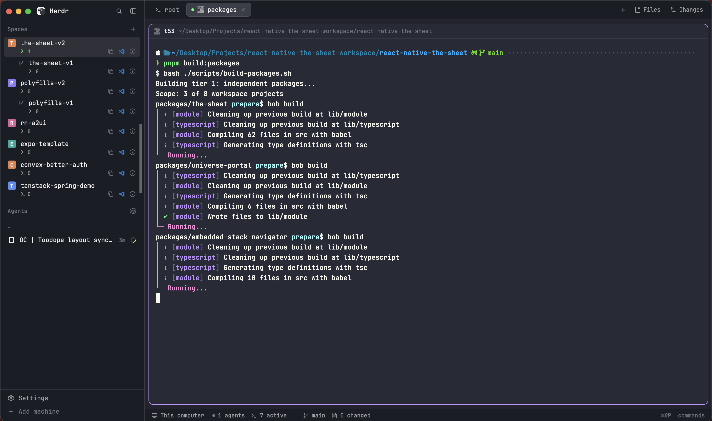

# herdr-app-toodope-layout

TooDope layout for Herdr App.



## Features

- **Spaces panel:**
  - Back/Forward navigation and a recent-spaces picker (clock
    button or Cmd+Shift+J on macOS; Ctrl+Shift+J on Windows/Linux)
  - Active-terminal count for space
  - File-change count for space
  - Copy absolute path button for space
  - Open in VS Code button for space
  - A space info tooltip
- **Tabs:** an indicator for the tab with the active terminal.
- **Pane header:** a button that copies the pane's full context.
- **Bottom bar:** active-space path and VS Code actions, plus machine-wide active-terminal count, branch, and file changes.

## Development

Install the repository's development tools and Git hooks with:

```sh
pnpm install
```

Husky runs `lint-staged` before commits and Commitlint checks Conventional Commit
messages. Prettier formats/checks JavaScript, JSON, Markdown, YAML, SVG, and
other supported text files with `pnpm format` and `pnpm format:check`.
Prettier does not format Python; after installing Ruff, run
`ruff format scripts/install.py`.

## Install or update

Requires Python 3.10 or newer. Run from this repository root:

```sh
python3 scripts/install.py
```

On Windows, use `py -3 scripts/install.py` if `python3` is not on PATH.

The installer checks `HERDR_APP_HOME`, `XDG_CONFIG_HOME/herdr-app`, and the
usual `~/.config/herdr-app` location (plus `%APPDATA%/herdr-app` on Windows).
To choose a config folder explicitly:

```sh
python3 scripts/install.py --config "/path/to/herdr-app"
```

It replaces only `layouts/TooDope.json` and the package's `mods/toodope-*`
folders. It also adds a recent-spaces shortcut scoped to the TooDope layout in
`keys.json` if that key is available: Cmd+Shift+J on macOS, Ctrl+Shift+J on
Windows/Linux. Existing key bindings are preserved; a conflict is reported
without being overwritten. It does not touch other layouts, mods, settings, or
Herdr-managed layout click state. After installation, select it with:

```sh
herdr-app do layout.switch --name TooDope
```

The gallery-ready layout package is in `TooDope/` (`layouts/`, `mods/`,
`RECIPE.md`, and `preview.png`). The preview shows the recent-spaces picker over
a running terminal. The installer has no third-party Python dependencies and
makes no network requests. The `toodope-spaces` mod runs
`hc`, `git`, and `code` commands and reads Git metadata from the workspaces it
shows; these operations are part of its active-process, repository-status, and
open-in-VS-Code features.

## VS Code Remote SSH

For Remote SSH hosts to work correctly across Mac and Windows, exclude these
machine-specific settings from Settings Sync:

- `Remote.SSH: Config File` (`remote.SSH.configFile`)
- `Remote.SSH: Default Extensions` (`remote.SSH.defaultExtensions`)
- `Remote.SSH: Remote Platform` (`remote.SSH.remotePlatform`)

## Connect Herdr App to WSL

The current WSL workflow connects over SSH. We will treat WSL as another machine

Here's the short version:

### Step 1: Install and start the SSH server in WSL

```bash
sudo apt update && sudo apt install openssh-server -y
sudo service ssh start
```

With systemd enabled, use `sudo systemctl enable --now ssh` so it starts
automatically.

### Step 2: Generate a key on Windows

In PowerShell:

```powershell
ssh-keygen -t ed25519
```

Press Enter to accept the defaults.

### Step 3: Add the public key to WSL

Print the key in PowerShell and copy the whole line:

```powershell
type $env:USERPROFILE\.ssh\id_ed25519.pub
```

Then in WSL:

```bash
mkdir -p ~/.ssh
nano ~/.ssh/authorized_keys    # paste the line, save
chmod 700 ~/.ssh
chmod 600 ~/.ssh/authorized_keys
```

### Step 4: Connect

In PowerShell:

```powershell
ssh yourusername@localhost
```

Replace `yourusername` with the output of `whoami` in WSL. If `localhost`
doesn't work, use the IP from `wsl hostname -I`.

> Before connecting or reconnecting in VS Code or Herdr App, make sure you ran `wsl` on
> PowerShell at least once to start the WSL service
