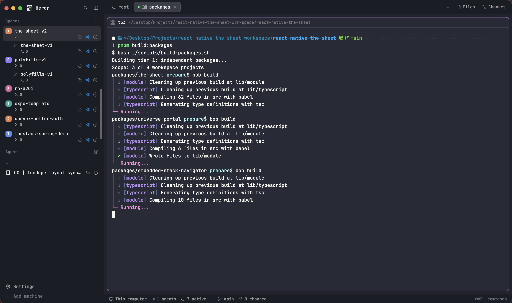

# TooDope

A TooDope keeps the base Herdr layout and adds a few useful twists: recent-space navigation and a picker, richer workspace details and actions, an active-terminal tab indicator, pane-context copying, and a more informative status footer. Herdr's built-in Spaces view groups worktrees under their main checkout; TooDope adds activity and Git-change details.

## What you see

- A 268px left rail with a 46px top brand/header block, a 38px strip of content-width Spaces/Agents tabs, a 31px contextual action row, one selected list filling the remaining space, and a 69px footer. Tab labels and the inline Agents count badge are centered as a group.
- A 42px top tab bar with program icons in 22px colored tiles matching the official Terminals layout, status badges, an active-terminal indicator, a new-tab menu, Files/Changes buttons, and window controls where the platform draws them.
- The main workspace uses 8px outer padding and gaps. Each pane has a 30px header with its short terminal ID pinned at the far right; clicking it copies terminal, pane, tab, and space details. Panes have 10px rounded corners, a border/focus treatment, and 14×12px terminal padding. The optional right panel is 368px wide (minimum 280px), starts hidden, and switches between Files and Changes.
- A 28px status footer shows the current machine, agent counts, active terminals, branch/change counts when available, active-space copy-path and VS Code actions, and the command-palette shortcut. Click the active-terminal count to open a centered list grouped by space; rows show only the tab name (or tab number when unnamed), not terminal or pane IDs or paths, with visible spacing between entries. Use ↑/↓ and Enter or click a row to jump to its tab and pane, and Esc to close. Keyboard navigation keeps the selected row visible while scrolling.

## How it behaves

- Select a space; right-click opens its menu. Back/Forward in the Spaces header follows navigation history. The clock button or Cmd+Shift+J on macOS (Ctrl+Shift+J on Windows/Linux) opens a centered dialog of recent spaces; use ↑/↓ and Enter or click a row to switch, and Esc to close. Keyboard navigation keeps the selected row visible while scrolling. Drag spaces to reorder within their machine. Worktrees are nested below their main checkout when Git metadata identifies the relationship.
- Switch the sidebar between Spaces and Agents with the tab strip. The selected list is the active child of the layout stack, so Herdr remembers it with the layout. Both views put their actions on a second row below the tabs: navigation/recent/new-space in Spaces, agent sorting in Agents. The Agents tab shows its current count and retains Herdr's priority/grouping, status, pinning, sub-agent, and focus behavior. On a compact rail the tabs read S and A.
- Space rows show active terminal and changed-file counts; hover the info icon for repo/branch/ahead/behind details. Path and VS Code buttons copy the active folder or open it in VS Code.
- The status footer's path and VS Code buttons act on the active space, so they remain available while the sidebar is closed.
- Click the status footer's active-terminal count to browse active processes across spaces. Use ↑/↓ to navigate, Enter to open the selected terminal, and Esc to close. Idle shells and non-working agents are excluded.
- Tabs can be selected, dragged to reorder, double-clicked to rename, right-clicked for their menu, and closed with the active tab's close button. A drag starts after a 400ms hold and 12px of movement; the source dims and an accent drop bar marks the insertion point. Leaving the bar cancels the drag. Program icons use the official Terminals layout's colored tile and overlaid agent-status dot: working, blocked, and done are color-coded; idle has no status badge. Active tabs with a foreground process show a separate green dot. In the compact space rail, blocked/done use a solid dot and working/idle use a small dot colored by status.
- The Files and Changes buttons show/hide the panel and switch its contents. That choice is remembered per space.
- Agent and workspace status colors follow the current Herdr theme. Space avatar colors are saved in shared Herdr state.

## Built from

- `layouts/TooDope.json`: root row, fixed sidebar, tab bar, active-tab workspace, hidden Files/Changes stack, and status footer.
- `toodope-sidebar-tabs`: a tab strip for the `sidebar-lists` stack; it reads `layout` and `agents`, and uses `layout.select` to switch between the two lists.
- `toodope-spaces`: workspace list, navigation history, Back/Forward and recent-space dialog controls, active-terminal and changed-file counts, copy-path and VS Code actions. It uses Herdr's built-in Spaces/worktree data along with `machines`, `panes`, `hc`, `exec`, `watchFolder`, `nextCommand`, local storage, shared state, overlays, and `space.select`/`space.move`/`space.new` commands. It runs `hc`, `git`, and `code` and reads Git metadata in displayed workspaces; it does not make network requests.
- `toodope-agents`: a TooDope-compatible copy of Herdr's shipped Agents list, with its inner heading omitted while shown under the sidebar tabs and its sort action on the second row. It opens Herdr's shipped Agents sort menu.
- `toodope-space-history`: centered dialog listing recently visited spaces, opened by the clock button in the Spaces header.
- `toodope-tabs-active-dot`: tab bar, panel controls, tab interactions, and platform window buttons. Uses shared state, layout/window data, overlays, and tab/layout/window commands.
- `toodope-workspace-status`: machine, agent, active-terminal activity/counts, Git status, and palette-key summary. It keeps terminal activity data fresh even while the sidebar is closed.
- `toodope-active-terminals`: centered dialog listing active terminals grouped by space, with navigation to the selected terminal.
- `toodope-pane-header`: the shipped pane header controls and status, plus a visible terminal ID that copies pane context when clicked.
- Shipped Herdr mods used by the layout: `workspace-chrome`, `agents`, `pane`, `files`, and `changes`; the tab bar opens shipped `menu` and `new-menu` overlays.
- Custom mod assets are included alongside their code under `mods/`.

## Watch out

- `preview.png` blurs the space list, tab labels, and terminal contents while leaving the layout chrome visible.
- The layout depends on the named shipped Herdr mods and commands being available in the installed Herdr version.
- Git status and foreground-process details depend on `git` and `hc`; Open in VS Code additionally depends on the `code` command being installed and available in the relevant machine's PATH.
- Git status refreshes on file changes where supported, with a slower fallback. Remote machines must be reachable for their data to update.
- The installer replaces only the package's layout filename and named mod folders. It leaves Herdr's generated `.state` data, settings, keys, and unrelated files alone.

## Done when

- `herdr-app check` passes for all eight custom mods (substitute the installed config path).
- The layout appears as `TooDope` and `herdr-app do layout.switch --name TooDope` opens the layout.
- Switching between the Spaces and Agents tabs works and the selected list fills the sidebar; selecting spaces/tabs, toggling Files/Changes, and viewing pane headers/footer work without a mod error.
- The bottom-bar active-terminal count updates while the sidebar remains closed.
- A quick tab click selects without starting a drag; a deliberate drag shows its drop bar and reorders on release, while leaving the tab bar cancels it.
- Tab program icons use the official Terminals colored-tile treatment at 22px, with proportionally smaller glyphs and status badges.
