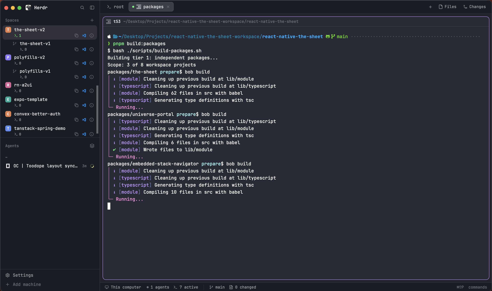

# TooDope

A TooDope keeps the base Herdr layout and adds a few useful twists: recent-space navigation and a picker, richer workspace details and actions, an active-terminal tab indicator, pane-context and agent-instruction copying, and a more informative status footer. Herdr's built-in Spaces view groups worktrees under their main checkout; TooDope adds activity and Git-change details.

## What you see

- A 268px left rail with a 46px top brand/header block, a 31px Spaces action row, one full-height Spaces list, and a 69px footer. The sidebar has no view tabs.
- A 42px top tab bar with vertically padded workspace tabs and an Agents control, program icons in 22px colored tiles matching the official Terminals layout, status badges, an active-terminal indicator, a new-tab menu, and window controls where the platform draws them.
- The main workspace uses 8px outer padding and gaps. Each pane has a 30px header with its short terminal ID pinned at the far right; clicking it copies terminal, pane, tab, and space details. A copy-instructions button sits just left of the ID: it copies a ready-to-paste prompt that gives the pane's agent its hc address, pane context, and preferences for delegating work and running long processes through `hc`. Panes have 10px rounded corners, a border/focus treatment, and 14×12px terminal padding. The optional right panel is 368px wide (minimum 280px), starts hidden, and shows Agents.
- A 28px status footer shows the current machine, agent counts, active terminals, branch/change counts when available, active-space copy-path and VS Code actions, and the command-palette shortcut. Click the active-terminal count to open a centered list grouped by space; rows show only the tab name (or tab number when unnamed), not terminal or pane IDs or paths, with visible spacing between entries. Use ↑/↓ and Enter or click a row to jump to its tab and pane, and Esc to close. Keyboard navigation keeps the selected row visible while scrolling.

## How it behaves

- Select a space; right-click opens its menu. Back/Forward in the Spaces header follows navigation history. Drag spaces to reorder within their machine: a drag starts after a 200ms hold and 6px of movement, the source dims, an accent horizontal drop line marks the insertion point above or below the hovered space, and row hover styling is suppressed while dragging so the line stays clear. The clock button or Cmd+Shift+J on macOS (Ctrl+Shift+J on Windows/Linux) opens a centered dialog of recent spaces; use ↑/↓ and Enter or click a row to switch, and Esc to close. Keyboard navigation keeps the selected row visible while scrolling. Worktrees are nested below their main checkout when Git metadata identifies the relationship. The Spaces header's add button, the tab bar's add menu, and Cmd+N on macOS (Ctrl+N on Windows/Linux) add a space directly after the selected one, on the same machine; a machine group's add button still adds at that machine's end.
- The left sidebar contains Spaces only. Agents opens in the right panel from the top tab bar and retains Herdr's priority/grouping, sorting, status, pinning, sub-agent, and focus behavior.
- Space rows show nonzero active-terminal, agent, and changed-file counts; the selected space has a theme-aware accent outline. Hover the info icon for repo/branch/ahead/behind details. Path and VS Code buttons copy the active folder or open it in VS Code.
- The status footer's path and VS Code buttons act on the active space, so they remain available while the sidebar is closed.
- Click the status footer's agent count next to the machine name to show or hide the Agents panel in the right panel, matching the tab bar's Agents control; the count is filled with an accent outline while Agents is showing.
- Click the status footer's active-terminal count to browse active processes across spaces. Use ↑/↓ to navigate, Enter to open the selected terminal, and Esc to close. Idle shells and non-working agents are excluded.
- Tabs can be selected, horizontally scrolled without changing the active tab, dragged to reorder, double-clicked to rename, right-clicked for their menu, and closed with the active tab's close button. A drag starts after a 200ms hold and 6px of movement; the source dims and an accent drop bar marks the insertion point. Leaving the bar cancels the drag, and tab hover styling is suppressed while dragging so the drop bar stays clear. Program icons use the official Terminals layout's colored tile and overlaid agent-status dot: working, blocked, and done are color-coded; idle has no status badge. Active tabs with a foreground process show a separate green dot. Compact Spaces rows center the row number and status mark together. In the compact space rail, blocked/done use a solid dot and working/idle use a small dot colored by status.
- The Agents button shows/hides the panel, and the footer's agent count does the same. That choice is remembered per space. Files and Changes panels are not part of the layout.
- Agent and workspace status colors follow the current Herdr theme. Space avatar colors are saved in shared Herdr state.
- Interactive rows and controls use a theme-aware stronger input surface with an accent border. Active/focused workspace and panel tabs use the selected surface with an accent outline; tab hover keeps the stronger neutral surface and accent border. Footer controls retain padded hit areas and rounded corners.

## Built from

- `layouts/TooDope.json`: root row, fixed Spaces sidebar, tab bar, active-tab workspace, hidden Agents panel stack, and status footer.
- `toodope-workspace-chrome`: the Herdr workspace header/footer with stronger theme-aware hover states.
- `toodope-spaces`: workspace list, navigation history, Back/Forward and recent-space dialog controls, active-terminal and changed-file counts, copy-path and VS Code actions. It uses Herdr's built-in Spaces/worktree data along with `machines`, `panes`, `hc`, `exec`, `watchFolder`, `nextCommand`, local storage, shared state, overlays, and `space.select`/`space.move`/`space.new` commands. The header's add button sends `toodope-workspace-status.new-space`, which inserts after the selected space. It runs `hc`, `git`, and `code` and reads Git metadata in displayed workspaces; it does not make network requests.
- `toodope-agents`: a TooDope-compatible copy of Herdr's shipped Agents list. In the right panel it shows its heading and sort control and retains Herdr's grouping, status, pinning, sub-agent, and focus behavior.
- `toodope-space-history`: centered dialog listing recently visited spaces, opened by the clock button in the Spaces header.
- `toodope-tabs-active-dot`: tab bar, panel controls, tab interactions, and platform window buttons. Uses shared state, layout/window data, overlays, and tab/layout/window commands. Its add menu opens `toodope-new-menu`, and its panel control shows Agents.
- `toodope-new-menu`: a TooDope-compatible copy of Herdr's New menu; its New space row sends `toodope-workspace-status.new-space`, so the tab bar's add menu inserts after the selected space too.
- `toodope-workspace-status`: machine, agent, active-terminal activity/counts, Git status, and palette-key summary. Its agent count shows/hides the right panel's Agents view through `layout.select`/`layout.show`/`layout.hide`, like the tab bar's control. It keeps terminal activity data fresh even while the sidebar is closed. It also handles the `new-space` command used by Cmd+N (Ctrl+N), the Spaces header's add button, and the tab bar's add menu: it runs `space.new` and then `space.move` to place the new space after the selected one, and the installer adds that key to the `layout:TooDope` section of `keys.json`.
- `toodope-active-terminals`: centered dialog listing active terminals grouped by space, with navigation to the selected terminal.
- `toodope-pane-header`: the shipped pane header controls and status, plus a visible terminal ID that copies pane context when clicked and a copy button that copies hc instructions for the pane's agent.
- Shipped Herdr mods used by the layout: `agents` and `pane`; TooDope's workspace chrome uses shipped icons, and the tab bar opens the shipped `menu` overlay and TooDope's `toodope-new-menu`.
- Custom mod assets are included alongside their code under `mods/`.

## Watch out

- `preview.png` blurs the space list, tab labels, and terminal contents while leaving the layout chrome visible.
- The layout depends on the named shipped Herdr mods and commands being available in the installed Herdr version.
- Git status and foreground-process details depend on `git` and `hc`; Open in VS Code additionally depends on the `code` command being installed and available in the relevant machine's PATH.
- Git status refreshes on file changes where supported, with a slower fallback. Remote machines must be reachable for their data to update.
- The installer replaces the package's layout and named mod folders, and removes its retired `toodope-sidebar-tabs` mod. It adds the recent-spaces and New space keys to `keys.json` without replacing bindings that are already taken, and leaves Herdr's generated `.state` data, settings, and unrelated files alone.
- The macOS menu bar's New Space item still runs Herdr's `space.new` and appends at the end; only the TooDope add button, the tab bar's add menu, and the bound New space key insert after the selected space. A person who bound that key to something else keeps their binding and gets Herdr's default behavior.

## Done when

- `herdr-app check` passes for all nine custom mods (substitute the installed config path).
- The layout appears as `TooDope` and `herdr-app do layout.switch --name TooDope` opens the layout.
- The Spaces list fills the left sidebar with no view tabs; the tab bar shows only an Agents control, with no Files or Changes buttons, and Agents switches the right panel without a mod error.
- Selecting Agents shows its heading, sort control, and full agent rows in the right panel without replacing the Spaces list, even when the left sidebar is compact.
- Clicking the status footer's agent count next to the machine name opens the right panel's Agents view, and clicking it again closes the panel.
- When the sidebar is compact, its header has an expand action that restores the saved sidebar width.
- The bottom-bar active-terminal count updates while the sidebar remains closed.
- Per-space agent counts use theme magenta (`ansi5`) without a border; the Agents panel retains Herdr's status and sorting behavior.
- Space rows hide the active-terminal count when it is zero and show nonzero per-space agent counts.
- The selected space has an accent outline in both expanded and compact sidebar modes.
- The focused agent has a selected fill and accent outline in the Agents panel, including while the Spaces sidebar is compact.
- A quick tab click selects without starting a drag; a deliberate drag shows its drop bar and reorders on release, while leaving the tab bar cancels it.
- A quick space click selects without starting a drag; a deliberate space drag suppresses row hover styling, shows a horizontal drop line, and reorders within the machine on release.
- Tab program icons use the official Terminals colored-tile treatment at 22px, with proportionally smaller glyphs and status badges.
- The pane header's copy-instructions button copies hc instructions containing that pane's terminal ID and context, and copied pane details contain only the details, with no extra instruction line.
- Sidebar rows, workspace tabs, panel controls, and the padded footer count show a clearly contrasting, theme-aware hover state in both light and dark appearances. Active/focused tabs have a distinct filled treatment without an underline.
- With a space selected, the Spaces header's add button, the tab bar's add menu, and Cmd+N (Ctrl+N) create the new space directly below the selected space, on the same machine, and show it.
